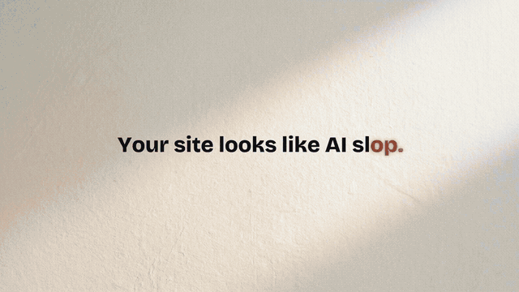

<div align="center">

# Launch Video Skill (`launch-video`)

**Turn any product URL into a studio-grade 60 FPS SaaS & devtool launch film, rendered 100% locally for $0.**

*Real 2x Retina UI captures. Living atmospheric plates. Apple Liquid Glass. 3D dual comparison windows. Wide-stereo `-14 LUFS` audio. Built to look hand-edited in After Effects, never AI slop.*

[](#)
[](#)
[](#)
[](#install-in-any-ai-agent)
[](./LICENSE)

</div>

---

## Live Demo (100% Generated by This Skill)

> Below is a real 32-second launch trailer generated directly from **`https://cohulo.com`** using the flagship **`cinema-launch`** style: `1920x1080`, `60 FPS`, lossless PNG pipe, and mastered wide-stereo `-14 LUFS` audio.

<div align="center">
  <a href="./demo/cohulo-launch-16x9.mp4" title="Watch full 1080p 60 FPS launch film with stereo audio">
    
  </a>
  <p>
    <a href="./demo/cohulo-launch-16x9.mp4"><strong>Watch / Download Full 1080p 60 FPS MP4 (with Stereo Audio)</strong></a>
  </p>
</div>

---

## Install in Any AI Agent

Works out of the box with **Google Antigravity**, **Claude Code**, **OpenAI Codex**, **Cursor**, **Windsurf**, **GitHub Copilot**, **OpenCode**, and any agent supporting the open `SKILL.md` standard.

### Option 1: One-Command Universal Install (Recommended)

Works across Claude Code, Cursor, Codex, Antigravity, Windsurf, and more via the Skills CLI:

```bash
npx skills add HazimBhatt/launch-video-skill
```

---

### Option 2: Direct Install by AI Agent

<details open>
<summary><strong>Google Antigravity (IDE &amp; CLI)</strong></summary>

**Global (available in every project):**

```bash
# macOS / Linux
git clone https://github.com/HazimBhatt/launch-video-skill.git ~/.gemini/config/skills/launch-video
```

```powershell
# Windows (PowerShell)
git clone https://github.com/HazimBhatt/launch-video-skill.git "$env:USERPROFILE\.gemini\config\skills\launch-video"
```

**Per-project (auto-shared with your team via Git):**

```bash
git clone https://github.com/HazimBhatt/launch-video-skill.git .agents/skills/launch-video
```

</details>

<details>
<summary><strong>Claude Code</strong></summary>

**Global (available across all repos):**

```bash
# macOS / Linux
git clone https://github.com/HazimBhatt/launch-video-skill.git ~/.claude/skills/launch-video
```

```powershell
# Windows (PowerShell)
git clone https://github.com/HazimBhatt/launch-video-skill.git "$env:USERPROFILE\.claude\skills\launch-video"
```

**Per-project:**

```bash
git clone https://github.com/HazimBhatt/launch-video-skill.git .claude/skills/launch-video
```

</details>

<details>
<summary><strong>OpenAI Codex (CLI &amp; App)</strong></summary>

**Global:**

```bash
# macOS / Linux
git clone https://github.com/HazimBhatt/launch-video-skill.git ~/.codex/skills/launch-video
```

```powershell
# Windows (PowerShell)
git clone https://github.com/HazimBhatt/launch-video-skill.git "$env:USERPROFILE\.codex\skills\launch-video"
```

**Per-project:**

```bash
git clone https://github.com/HazimBhatt/launch-video-skill.git .agents/skills/launch-video
```

</details>

<details>
<summary><strong>Cursor</strong></summary>

**Global:**

```bash
# macOS / Linux
git clone https://github.com/HazimBhatt/launch-video-skill.git ~/.cursor/skills/launch-video
```

```powershell
# Windows (PowerShell)
git clone https://github.com/HazimBhatt/launch-video-skill.git "$env:USERPROFILE\.cursor\skills\launch-video"
```

**Per-project:**

```bash
git clone https://github.com/HazimBhatt/launch-video-skill.git .cursor/skills/launch-video
```

</details>

<details>
<summary><strong>Windsurf, GitHub Copilot, OpenCode &amp; Other Agents</strong></summary>

Drop the repository into your project's standard `.agents/skills/` folder:

```bash
git clone https://github.com/HazimBhatt/launch-video-skill.git .agents/skills/launch-video
```

Any agent that reads `SKILL.md` files will automatically discover and activate `launch-video` when you ask for a launch video.

</details>

---

### One-Time Local Environment Check

After installing the skill, run the built-in setup checker once (or let your AI agent run it automatically):

```bash
node scripts/setup.mjs
```

**Requirements (all free & local):**
- **Node.js 18+**
- **Google Chrome / Chromium** (headless Canvas 2D + Three.js rendering)
- **FFmpeg** (60 FPS lossless PNG pipe -> H.264/AAC MP4)
- **Python 3.11+** (auto-configured venv for procedural stereo soundtrack + optional Kokoro-82M neural TTS & Whisper `small.en` word-synced captions)

---

## Just Prompt Your Agent

Once installed, open your AI agent and paste a prompt like:

```text
Use the launch-video skill to create a 30-second 16:9 launch video for https://yourproduct.com in cinema-launch style with upbeat electronic audio.
```

More prompts to try:
- *"Make both a 16:9 Product Hunt trailer and a 9:16 X/Reels cut for `https://my-app.io` using `launch-video`."*
- *"Turn my CLI tool `https://tracepulse.dev` into a `terminal-launch` video with Kokoro narration and word-synced captions."*
- *"Create a metric-driven `bento-proof` launch video for `https://analytics.dev` highlighting our $19/mo flat pricing."*

---

## Why It Doesn't Look Like AI Slop

1. **Real 2x Retina Product Captures (`scripts/probe.mjs`)**: Crawls your live URL at `deviceScaleFactor: 2` (`2880x1800`) to extract authentic screenshots, SVG logos, color tokens, fonts, headlines, metrics, and interactive Before/After UI states. Zero Lorem Ipsum, zero fake mockups.
2. **Living Photographic Atmospheric Worlds**: Stages your real UI inside crisp sunlit daylight sky plates, architectural paper light, and subtle film grain instead of flat static fills or generic purple bokeh blobs.
3. **True Apple Liquid Glass & Optical Camera Choreography**: Uses real frosted-glass refraction cards, `2.8x` optical macro camera pushes, spring-physics Bezier cursor clicks pinned to exact button coordinates, pixel-mosaic block wipes, and transparent-alpha 3D angled Before/After macOS comparison windows.
4. **Dual Audio Modes (`-14 LUFS` Mastered Stereo)**:
   - **Kinetic Electronic Beats (`--mode beats`)**: Procedural 48 kHz wide-stereo soundtrack with sidechained pads, stereo ping-pong delay, tactile mechanical Foley SFX, and `-14 LUFS` / `-1.0 dBTP` loudness mastering (or drop in your own licensed `.mp3`).
   - **Narrated Mode**: Local Kokoro-82M neural voiceover + Whisper `small.en` word-level caption synchronization at $0 API cost.
5. **Dual Aspect (`16:9` + `9:16`)**: Render widescreen `1920x1080` (X, Product Hunt, YouTube) and vertical `1080x1920` (Reels, TikTok, Shorts) from the exact same choreography.
6. **Mandatory Visual & Audio QA Gate**: Automatically exports contact sheets, full-res lossless PNG keyframes at every hero cut, and runs FFmpeg loudness/frame-rate verification before signing off.

---

## 6 Built-In Launch Styles

| Style | Best For | Visual & Audio Signature |
| :--- | :--- | :--- |
| **`cinema-launch`** *(Flagship Default)* | Viral X/Twitter launch films, Product Hunt trailers, design-forward AI & SaaS demos | Photographic sky & paper plates, scramble-decode opener, Apple Liquid Glass, 2.8x macro cursor push, 3D dual Before/After windows, pixel-mosaic wipes, 60 FPS `-14 LUFS` stereo anthem |
| **`macro-studio`** | Minimalist architectural UI walkthroughs | Warm sand/carbon contrast, macro UI focus cuts, wide-stereo beat sync |
| **`bento-proof`** | Metric-heavy v2 launches & ROI proof grids | Swiss architectural white grid, crisp sparklines, browser staging |
| **`kinetic-noir`** | Dark-mode devtools, infra & AI startups | Deep obsidian canvas, Three.js 3D slab, 124 BPM kinetic beats |
| **`problem-story`** | Founder-story explainers & workflow SaaS | Warm `#F7F5EE` paper, `Caladea` serif typography, narrated pain-to-payoff arc |
| **`terminal-launch`** | CLIs, SDKs, APIs & Show HN launches | Phosphor carbon terminal, live command typing + diff proof, narrated or beats |

---

## Manual CLI Workflow (Under the Hood)

Your AI agent runs this 6-step pipeline automatically, or you can invoke it directly:

```bash
# 1. Verify / set up local tools (Node, Chrome, FFmpeg, Python audio env)
node scripts/setup.mjs

# 2. Probe a live product URL -> brand.json + 2x Retina screenshots
node scripts/probe.mjs https://yourproduct.com ./my-launch-probe

# 3. Scaffold a launch video project
node scripts/new_video.mjs cinema-launch my-launch --from ./my-launch-probe --aspect 16:9 --mode beats

# 4. Generate beat timing, cues & -14 LUFS wide-stereo mix
node scripts/py.mjs scripts/beats.py ./my-launch
node my-launch/tools/capture.mjs check
node my-launch/tools/capture.mjs cues
node scripts/py.mjs my-launch/tools/mix.py ./my-launch

# 5. Inspect visual contact sheet & full-res keyframes
node my-launch/tools/capture.mjs sheet review/all.jpg 0.5 6
node my-launch/tools/capture.mjs frames review/keyframes "0.9,2.6,4.9,14.2,28.8"

# 6. Render final 1080p 60 FPS lossless-pipe H.264/AAC MP4
node my-launch/tools/capture.mjs video renders/launch-16x9.mp4 --fps=60
```

---

## Contributing & License

Pull requests for new styles, transitions, and audio presets are welcome. Licensed under the [MIT License](./LICENSE).

Built by [Hazim Bhatt](https://github.com/HazimBhatt) · Demo filmed for [Cohulo](https://cohulo.com).
